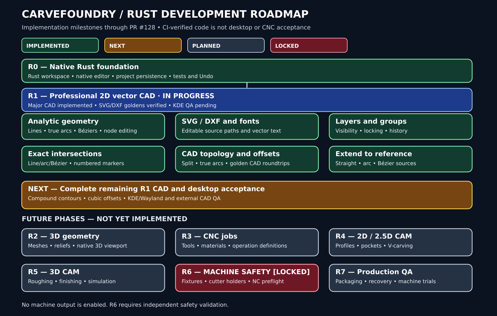

# CarveFoundry — full Rust roadmap and verified progress

**Verified snapshot:** 2026-10-10/11. Latest Rust CAD feature:
[R1k analytic mixed-offset integrity PR #124](https://github.com/newnetmp3/CarveFoundry/pull/124),
merged as `108a93a21bfca8a2a519e740d60991dc6a9f84ed`.
Its exact tested feature head `9560aa89ef74098f7e0151f4685a30e3b2d22e8f`
passed [Rust CI #38105033834](https://github.com/newnetmp3/CarveFoundry/actions/runs/38105033834):
**113 core + 18 studio = 131 tests**, strict Clippy and Linux release.
Previous R1j tangent mixed line/arc offsets PR #123 and R1a–R1i
remain merged; the high-contrast static roadmap is retained.

[Open the full-size high-contrast SVG](ROADMAP_HIGH_CONTRAST.svg). This graphic has explicit foreground/background colors and requires **no Mermaid parser or theme initialization**. If an extension blocks images, the phase/status table below contains the same information.

## What these statuses mean

| Phase | Verified software so far | Outstanding acceptance |
|---|---|---|
| R0 | Rust CAD foundation, desktop and project/Undo tests | Comprehensive real KDE/Wayland user testing |
| **R1** | Baseline 2D CAD, SVG/DXF, text, groups/layers, exact splits/trims/intersections, straight/arc/Bézier source extension, tangent line/circular offsets and mixed-offset analytic self-crossing checks | Sharp curved junction joins, cubic offsets, coincident-circle sweep classification, whole-offset topology acceptance, KDE UX and independent SVG/DXF fixtures |
| R2 | Not implemented in pure Rust reboot | 3D mesh/relief workspace and viewport |
| R3 | Not implemented | CNC job, tool/material catalogs, dependency invalidation |
| R4 | Not implemented | 2D/2.5D machining and safe operation geometry |
| R5 | Not implemented | 3D machining and trustworthy stock simulation |
| R6 | Intentionally **blocked** | Holder/fixture/stock/machine-travel/postprocessed NC preflight and independent safety review |
| R7 | Not implemented | Packaging, recovery, migrations, goldens and real machine scrap testing |

**No invented overall percentage.** R0 and code-delivered portions of R1
have CI verification, not blanket real-desktop certification. R2–R7 differ
vastly in scope from R1 and are not equally weighted. Machine NC export
remains disabled until all independent R6 validation gates are ready.

See [INTERSECTION_EDITING.md](INTERSECTION_EDITING.md) for supported
line/arc/Bézier intersections, [CURVE_EXTENSION.md](CURVE_EXTENSION.md)
for exact Bézier/arc extension, and [TOPOLOGY_EDITING.md](TOPOLOGY_EDITING.md)
for other source-preserving numeric edits. See [TANGENT_OFFSETS.md](TANGENT_OFFSETS.md) for exact line/arc offsets and R1k whole-chain intersection validation, plus explicit refusal cases.
